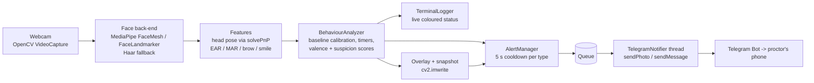

# AI Proctoring & Behaviour Analysis System

**Hackathon Problem Statement ID 102** - real-time webcam proctoring with live terminal logging and instant **Telegram Bot** alerts (with a snapshot of every violation).

Runs 100 % locally: `python main.py`

---

## Features

| Capability | How it works | Alert text |
|---|---|---|
| **Face presence** | face tracker finds no face for > 1 s | `NO FACE DETECTED` |
| **Multiple people** | more than one face for > 0.5 s | `MULTIPLE FACES DETECTED - CHEATING ALERT` |
| **Head pose / gaze** | `solvePnP` head pose (yaw / pitch) vs. the candidate's own calibrated baseline; Left / Right / Up / Down away for > 2 s | `LOOKING AWAY FROM SCREEN (LEFT)` |
| **Behaviour & valence** | eye / mouth / brow geometry + head-motion analysis -> **Focused**, **Distracted**, **Suspicious Movement**, valence (-1 .. +1), suspicion (0-100) and focus (0-100) scores | shown live in terminal + video overlay |
| **Telegram alerts** | `requests.post` to the Bot API: `sendPhoto` with timestamp, violation type, valence and suspicion score; automatic `sendMessage` fallback | - |
| **Anti-spam cooldown** | 5 s per violation type (configurable); sending happens on a background thread so video never lags | - |

---

## Architecture



```
 Webcam -> Face detection -> Head pose + facial features -> Behaviour analysis -> Terminal log
                                                                  |
                                                                  +--> violation? -> cooldown -> snapshot -> Telegram Bot
```

### Project structure

```
proctoring_ai_102/
|-- main.py              # capture + detection + analysis + terminal logger + Telegram sender
|-- config.py            # settings (reads secrets from .env)
|-- .env.example         # template for TELEGRAM_BOT_TOKEN / TELEGRAM_CHAT_ID
|-- requirements.txt
|-- .gitignore
|-- package_project.py   # builds proctoring_ai_102.zip
`-- README.md
```

---

## Quick start

> Requires **Python 3.9 - 3.12** (MediaPipe ships wheels for these) and a webcam.

```bash
# 1. (recommended) virtual environment
python -m venv .venv
source .venv/bin/activate            # Windows:  .venv\Scripts\activate

# 2. install dependencies
pip install -r requirements.txt

# 3. configure Telegram
cp .env.example .env                 # Windows:  copy .env.example .env
#    then edit .env and paste your token + chat id (see below)

# 4. check the bot works
python main.py --test-telegram

# 5. run the proctor
python main.py
```

On first start the system **calibrates for ~1 second** - look straight at the screen. Press **`c`** in the video window any time to recalibrate, **`q`** / **ESC** to quit (Ctrl+C also works).

### Telegram setup (2 minutes)

1. In Telegram open **@BotFather**, send `/newbot`, follow the prompts and copy the **token**.
2. Open a chat with your new bot and send it any message (e.g. "hi").
3. Visit `https://api.telegram.org/bot<YOUR_TOKEN>/getUpdates` in a browser and copy the number in `"chat":{"id": ... }` - that is your **chat id**. (For a group: add the bot to the group, send a message, and use the negative id shown.)
4. Put both values in `.env`:
   ```
   TELEGRAM_BOT_TOKEN=123456789:AAExampleToken
   TELEGRAM_CHAT_ID=987654321
   ```

If the credentials are missing the system still runs and logs every violation locally; it just skips Telegram.

### Command-line options

```
python main.py [--camera N] [--no-window] [--backend auto|legacy|tasks|haar] [--test-telegram]
```

---

## What the terminal shows

```
[14:03:21] FOCUSED              | faces=1 | gaze=CENTER yaw=  +1.8 pitch=  -0.9 | valence=+0.04 (Neutral) | suspicion=  3/100 | focus= 97/100
[14:03:22] DISTRACTED           | faces=1 | gaze=LEFT   yaw= -31.2 pitch=  +2.0 | valence=+0.02 (Neutral) | suspicion= 51/100 | focus= 49/100
[14:03:24] LOOKING AWAY         | faces=1 | gaze=LEFT   yaw= -33.0 pitch=  +1.1 | valence=-0.03 (Neutral) | suspicion= 72/100 | focus= 28/100  <<< LOOKING AWAY FROM SCREEN (LEFT)
[14:03:24] [ALERT] LOOKING AWAY FROM SCREEN (LEFT) | valence=-0.03 (Neutral) | suspicion=72/100 | snapshot=snapshots/looking_away_20261021_140324_512.jpg
[14:03:25] [OK]    Telegram alert delivered: LOOKING AWAY FROM SCREEN (LEFT)
```

The Telegram message contains: timestamp, violation type, valence, suspicion score and the annotated snapshot.

*Left / Right are from the candidate's own point of view.* If they feel reversed on your setup, set `MIRROR_DIRECTIONS=true` in `.env`.

---

## How the scores are computed (be transparent with the judges)

* **Head pose** - six facial landmarks are matched to a generic 3-D face model with `cv2.solvePnP`; yaw / pitch are measured **relative to your calibrated neutral pose**, so a laptop camera that sits below eye level does not cause false alarms. The calibration can never be "hidden" off-axis (baseline clipped to +/-20 deg).
* **Valence** - a geometric heuristic: mouth-width increase (smile) raises it, inner-brow narrowing (frown) and raised brows lower it, all relative to the candidate's own baseline, then smoothed. It is **not a trained emotion classifier**.
* **Suspicion (0-100)** - weighted blend of gaze deviation, how long the candidate has been looking away, rapid head swings, mouth movement (talking), long eye closure and negative valence. No face = 60-100, multiple faces = 95. **Focus = 100 - suspicion.**
* **Suspicious Movement** status - rapid left-right head swings (> 45 deg range within 2 s) or sustained mouth movement. Set `ALERT_ON_SUSPICIOUS_MOVEMENT=true` to also send Telegram alerts for it.

### Detection back-ends (chosen automatically)

| Back-end | When it is used | Notes |
|---|---|---|
| MediaPipe **FaceMesh** (legacy `solutions` API) | older MediaPipe releases | no download needed |
| MediaPipe **FaceLandmarker** (Tasks API) | current MediaPipe releases | downloads a ~4 MB model to `models/` on first run (internet needed once) |
| OpenCV **Haar cascade** | last-resort fallback | face count + presence + coarse gaze only; no valence |

Force one with `--backend` or `FACE_BACKEND=` in `.env`.

---

## Configuration

Everything can be overridden in `.env` (see `.env.example`):

| Variable | Default | Meaning |
|---|---|---|
| `TELEGRAM_BOT_TOKEN`, `TELEGRAM_CHAT_ID` | - | bot credentials |
| `ALERT_COOLDOWN_SECONDS` | 5 | minimum gap between alerts of the same type |
| `LOOK_AWAY_SECONDS` | 2 | look-away time before it counts as a violation |
| `YAW_THRESHOLD_DEG` / `PITCH_THRESHOLD_DEG` | 25 / 18 | how far the head may turn left-right / up-down |
| `NO_FACE_SECONDS` / `MULTI_FACE_SECONDS` | 1 / 0.5 | debounce before those violations fire |
| `CAMERA_INDEX` | 0 | which webcam |
| `SHOW_WINDOW` | true | show the annotated video window |
| `FLIP_FRAME` | false | set true only if your camera image is mirrored |
| `MIRROR_DIRECTIONS` | false | swap LEFT/RIGHT labels |
| `FACE_BACKEND` | auto | `auto`, `legacy`, `tasks`, `haar` |
| `ALERT_ON_SUSPICIOUS_MOVEMENT` | false | also alert on suspicious movement |

Violation snapshots are saved in `snapshots/` (git-ignored).

---


## Troubleshooting

| Problem | Fix |
|---|---|
| `Cannot open camera index 0` | close Zoom/Teams/browser tabs using the camera, try `--camera 1`, allow camera access for your terminal in OS privacy settings |
| `No matching distribution found for mediapipe` | use Python 3.9 - 3.12 |
| `Back-end 'tasks' is not available: model file not available` | no internet on first run - download `face_landmarker.task` from the MediaPipe model page once and place it in `models/` (or set `FACE_LANDMARKER_MODEL_PATH`) |
| Head pose looks wrong / always "away" | your camera image may be mirrored - set `FLIP_FRAME=true`; press `c` to recalibrate |
| Too many false "looking away" alerts | raise `YAW_THRESHOLD_DEG` / `PITCH_THRESHOLD_DEG` or `LOOK_AWAY_SECONDS` |
| Telegram `rejected (HTTP 401)` | wrong token - recreate it with @BotFather |
| Telegram `rejected (HTTP 400/403)` | wrong chat id, or you have not sent your bot a first message |
| `cv2` import conflicts after installing | `pip uninstall -y opencv-python opencv-contrib-python` then `pip install opencv-python` |

---

## Responsible-use note

Automated proctoring produces **false positives** (poor lighting, glasses, a camera at an odd angle) and its emotion/valence estimate is heuristic. Treat alerts as *flags for a human reviewer*, never as proof of misconduct, and always obtain the candidate's informed consent before recording or analysing their video.

Built for **Hackathon Problem Statement ID 102 - AI Proctoring & Behaviour Analysis System.**


## Android setup (Acode + Termux)

**Acode is the editor; Termux runs the Python commands.** This project uses OpenCV, MediaPipe and webcam access, so running it directly on Android/Termux is not guaranteed. In particular, MediaPipe may not provide a compatible Android/Termux wheel, and `cv2.VideoCapture(0)` usually will not automatically access the phone camera. For a reliable full run, use a supported desktop Python environment (Python 3.9–3.12) with a webcam. The steps below let you prepare the project and check compatibility on Android.

### 1. Install tools in Termux

Install Termux from a trusted source, open it, then run:

```bash
pkg update && pkg upgrade -y
pkg install python git clang cmake rust -y
```

### 2. Download the repository

If the repository is public:

```bash
cd ~
git clone https://github.com/MayanKiz/proctoring_ai_102.git
cd proctoring_ai_102
```

If GitHub says the repository is private, authenticate with an authorized GitHub account or download the source while signed in. Do not put access tokens directly into commands or commit them to the repository.

If the project folder is already present, enter that folder instead of cloning it again:

```bash
cd ~/proctoring_ai_102
ls
```

### 3. Try installing dependencies

```bash
python --version
python -m venv .venv
source .venv/bin/activate
python -m pip install --upgrade pip
pip install -r requirements.txt
```

If installation fails at `mediapipe`, `opencv-python`, or another compiled dependency, this is a platform compatibility issue rather than an Acode editor issue. Do not assume the app is working until all dependencies install successfully.

### 4. Configure Telegram (optional)

```bash
cp .env.example .env
nano .env
```

Add your own `TELEGRAM_BOT_TOKEN` and `TELEGRAM_CHAT_ID` values in `.env`, save the file, and keep it private. The real `.env` file is ignored by Git. If you do not configure Telegram, local logging can still work on a supported platform.

### 5. Start the program

```bash
python main.py
```

To test Telegram alerts after configuring credentials:

```bash
python main.py --test-telegram
```

**Android limitations:** The application expects a camera source that OpenCV can open and a supported MediaPipe installation. A phone's built-in camera is not guaranteed to appear as camera index `0` in Termux. If either dependency installation or camera access fails, run the project on a desktop/laptop with Python 3.9–3.12 and a webcam, or adapt the camera input and inference stack specifically for Android.
